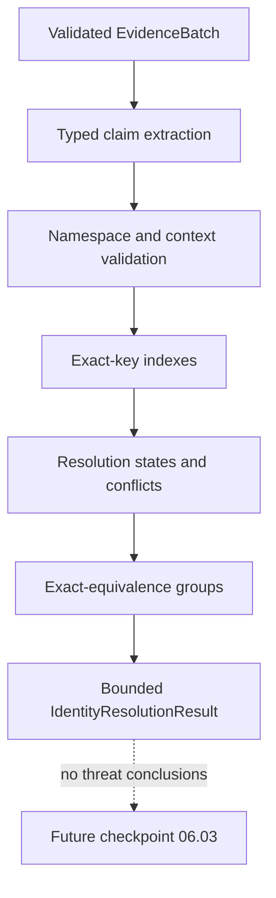

# Cross-Module Identity Resolution

Phase 06 checkpoint 06.02 adds a deterministic internal engine over the
immutable evidence contracts from 06.01. It resolves only exact, typed identity
claims and explicit contextual references. It does not correlate threats or
produce security findings.

```text
evidence identity != subject identity != observation context
                  != relationship evidence != correlation
```

## Architecture



The public evidence value is never copied into the result. `IdentityReference`
contains a deterministic digest of identity type, namespace, scope and
canonical value plus a safe scope category. The digest remains correlatable and
is explicitly not treated as anonymous.

## Source identity inventory

| Domain | Preserved subject | Namespace and strength | Context retained | Resolution consequence |
|---|---|---|---|---|
| Static | File-content SHA-256 | `sha256`, content strength, accepted-byte-stream scope | Phase 02 module, analysis UUID, start/completion clocks, local derivation | Equal canonical SHA-256 supports content-digest identity only. Different/invalid algorithms are unresolved. |
| Synthetic ML | Phase 02 analysis reference plus model metadata | Source-scoped `analysis_uuid`; model ID exists but independent model version is absent | Phase 03, synthetic origin, dataset digest, no inference clock | Analysis identity can resolve only inside the Phase 03 source scope. Versioned model identity is `unresolved`. It does not identify file content without an explicit reference. |
| Vulnerability | Validated CVE | `cve`, public namespace identity | Phase 04, generated/provider clocks, external-reported origin | Equal CVE resolves the same vulnerability subject. It does not identify a product installation, exposure, exploit or compromised asset. |
| Behavioral | Phase 05 analysis UUID | Source-scoped `analysis_uuid` | Generated time, declared or synthetic provenance | Analysis identity is not host/device/process identity. Raw PID, host scope and process instance ID were minimized by 06.01 and remain unresolved. |

Behavioral unified evidence retains ATT&CK candidate counts but not individual
technique ID, STIX ID, domain and catalog-version tuples. ATT&CK identity is
therefore unresolved at this layer. The engine does not reopen Phase 05 output
or reconstruct minimized data.

## Contracts

`app/schemas/identity.py` defines:

- `IdentityReference` and `IdentityNamespace`;
- `IdentityClaim` and availability;
- `IdentityResolutionRequest` and `IdentityResolutionResult`;
- `IdentityResolutionStatus`;
- `IdentityMatchEvidence` and `IdentityConflict`;
- `IdentityContext` and `ResolvedIdentityGroup`;
- `IdentityResolutionRule` and `IdentityResolutionSummary`.

All contracts are strict and frozen. Content-derived IDs for claims, matches,
conflicts and groups are recalculated during validation. The result revalidates
nested IDs, deterministic ordering, summary counts and encoded size rather than
trusting caller-visible objects.

## Static rule registry

| Rule | Purpose | Required evidence | Positive meaning |
|---|---|---|---|
| `IR-FILE-001` | File-content identity | SHA-256, digest, accepted-byte scope | Same content digest only |
| `IR-CVE-001` | Vulnerability identity | Canonical CVE and namespace | Same vulnerability subject only |
| `IR-ANALYSIS-001` | Analysis identity | UUID, source module and scope | Same source-scoped analysis only |
| `IR-MODEL-001` | Versioned ML model identity | Model ID, independent version and dataset digest | Unresolved for current Phase 03 output |
| `IR-PROC-001` | Process-instance identity | Host scope, process-instance UUID and temporal context | Unresolved because 06.01 does not retain these attributes |
| `IR-ATTACK-001` | Versioned ATT&CK identity | Technique ID, STIX ID, domain and catalog version | Unresolved because 06.01 retains counts only |
| `IR-REF-001` | Explicit derivation context | Validated source and target evidence IDs | `compatible_context`, never identity |
| `IR-DOMAIN-001` | Unsupported domain comparison | A supported identity rule | `not_comparable` when none exists |

The registry is immutable and ordered. It accepts no client expressions,
plugins, code, fuzzy text, embeddings, LLM output or field-name-derived rules.

## Resolution states

- `same_identity`: an exact registered equivalence rule is satisfied.
- `compatible_context`: an explicit reference supplies context but not identity.
- `insufficient_evidence`: indispensable attributes are absent.
- `conflicting_identity`: explicit source-analysis claims disagree.
- `not_comparable`: preserved attributes have no valid comparison rule.

Only `same_identity` can create a `ResolvedIdentityGroup`. Compatibility is
never transitive. Conflicted evidence is excluded from groups, and no source is
chosen as authoritative by arrival order or trust label.

## Complexity and bounds

Claims and references are indexed by typed canonical keys. Complexity is
`O(n log n + r + d²)`, where `n <= 256` records, `r` is bounded by the existing
16 references per record, and `d <= 4` source domains. There is no all-record
Cartesian comparison or exponential reconstruction.

The engine allows at most 512 claims, 512 match records, 256 conflicts, 256
groups, 256 members per group and a 1 MiB output. Deterministic truncation is
reported in the summary. It preserves the 06.01 limits of 256 evidence records,
32 KiB per record and 1 MiB per evidence batch.

No API endpoint was added. The resolver is a Python-only foundation and cannot
be used by an HTTP client to inject accredited claims or dynamic rules.
