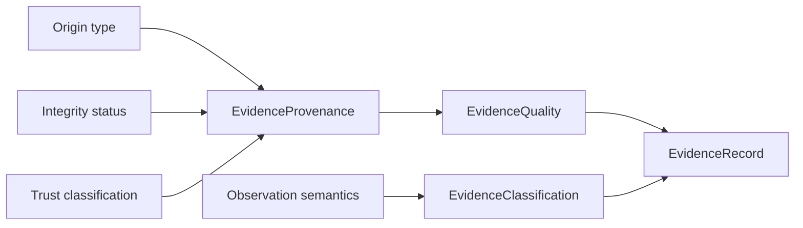
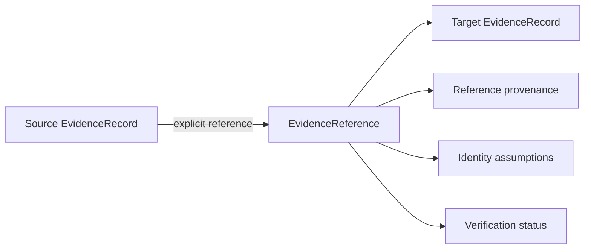

# Evidence Provenance and Trust

The evidence layer represents provenance, integrity, schema validity,
credibility and factual certainty as separate properties. It intentionally has
no numeric trust or threat score.

## Origin and trust vocabulary

| Origin | Allowed trust classes | Meaning |
|---|---|---|
| `client_declared` | `client_declared`, `derived_evidence` | The consumer supplied the underlying telemetry. Backend validation does not authenticate its real-world origin. |
| `synthetic_generated` | `internal_derivation`, `derived_evidence` | A deterministic educational generator or synthetic-model workflow created it. |
| `locally_derived` | `internal_derivation`, `derived_evidence` | A bounded backend engine derived it locally from accepted input. |
| `external_intelligence` | `external_reported`, `versioned_knowledge` | A named external provider reported it. Transport/schema handling is not cryptographic proof of the provider's underlying claims. |

The contract rejects invalid combinations. Client-declared and external
intelligence origins cannot set `origin_verified=true`. Synthetic status must
exactly match `synthetic_generated`. A caller therefore cannot turn declared
telemetry into versioned knowledge or verified external intelligence by
changing labels.

`integrity_verification` describes the handling of the representation, not
truth in the world. `structurally_valid`, `integrity_verified`,
`origin_unverified`, `partial`, `contradictory`, and `not_applicable` are
categorical states. A valid schema is not proof of provenance; a verified hash
is not proof of benign or malicious meaning.

## Quality

`EvidenceQuality` keeps completeness, consistency, temporal precision,
identity strength, provenance availability and verification status separate.
Its overall state is one of `sufficient`, `incomplete`, `contradictory`,
`not_applicable`, or `unverifiable_provenance`. There is no aggregation formula
and no positive threat class.

Timestamp entries always carry their meaning. Analysis start/completion,
generated, event, observed, received, intelligence publication/modification
and retrieval are different clocks. Aware timestamps normalize to UTC. Missing
clocks remain missing; proximity is never converted into causality.

## Explicit references

A reference declares both evidence IDs, an explicit type, how it was
established, its identity assumptions and verification status. Both records
must exist in the immutable batch. Self-reference, dangling targets, cycles
and mismatched same-subject claims are rejected. Checkpoint 06.01 creates no
cross-module reference automatically.

## Security and privacy boundary

Adapters are internal typed functions. No evidence-ingestion endpoint exists,
so HTTP consumers cannot submit an object as an accredited engine result. The
models omit command lines, full paths, usernames, hostnames, IP addresses,
secrets, configuration targets and raw provider text. Deterministic identifiers
are stable, not anonymous. Records should be disclosed only where their scoped
identifiers are needed.

The evidence package imports no HTTP, socket, filesystem, subprocess,
database, persistence, LLM or embedding facility. Normalization performs
bounded validation, canonical serialization and hashing only.
