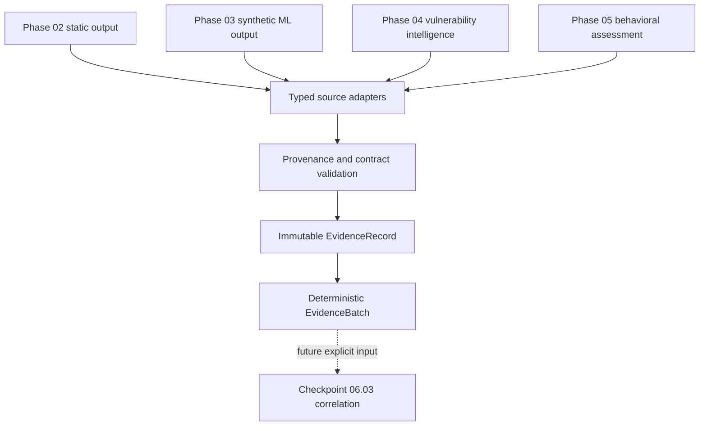
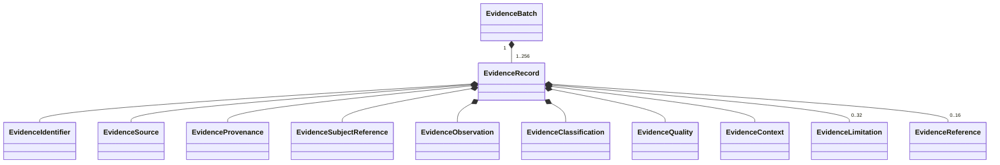

# Unified Evidence Model

Phase 06 checkpoint 06.01 introduces an internal, immutable normalization
boundary for outputs from Phases 02 through 05. It does not correlate those
outputs. The governing distinction is:

```text
source output != evidence != correlation != assessment
```

## Architecture and boundary



`app/schemas/evidence.py` owns the bounded contracts. `app/evidence/adapters.py`
is the only conversion layer. It accepts already validated Python model
instances; no HTTP route accepts a caller-labelled "trusted internal" result.
The layer performs no network, filesystem, command, persistence, model
execution, source-engine rerun, entity matching, or inference.

## Source contract inventory

| Phase | Actual source contract and principal API | Identity and clocks available | Provenance, state, and important limits | Evidence adapter behavior |
|---|---|---|---|---|
| 02 Static | `StaticAnalysisResponse`; `POST /api/v1/static-analyses/` | `analysis_id`, SHA-256, byte size; analysis start/completion UTC | Local byte derivation; completed only; filename and extracted content may be sensitive; configured upload/string/indicator limits | Keeps SHA-256, size, format, consistency, indicator count and both analysis clocks. Omits filename, extracted strings, and indicator values. It never asserts execution. |
| 03 Synthetic ML | `MLInferenceResponse`; `POST /api/v1/ml-inferences/` | `inference_id`, referenced `analysis_id`, model/experiment/dataset IDs and dataset digest; no inference timestamp and no distinct model version | `synthetic_demo`, synthetic dataset, uncalibrated probabilities, registered-demo lifecycle, mandatory limitations | Keeps prediction, model ID, dataset context and digest. Records model version and timestamp as unavailable. Classification remains `educational_prediction`, never a fact or verdict. |
| 04 Vulnerability | `UnifiedVulnerabilityIntelligenceResponse`; `GET /api/v1/intelligence/vulnerabilities/{cve_id}` and bounded assessment POST | `correlation_id`, exact CVE; generated, NVD publication/modification, provider retrieval and EPSS score-date semantics where present | Independent NVD/CISA KEV/FIRST EPSS source states; external origin is reported, not cryptographically authenticated; source failures may be partial | Keeps exact CVE and provider states/counts with distinct clocks. Omits descriptions, URLs, CPE strings and product text. Never asserts exploitation or maps CVE to ATT&CK. |
| 05 Behavioral | `BehavioralAnalysisResult`; `POST /api/v1/behavior/analyze` and `/behavior/scenarios/analyze` | `analysis_id`; generated UTC; raw event IDs/times exist upstream but are not reproduced by the minimized adapter | Declared or deterministic synthetic origin; complete/partial/unavailable; rule, temporal and ATT&CK candidate summaries; raw telemetry is sensitive | Keeps bounded counts, status, unknowns, provenance nature and generated time. Omits events, host IDs, commands, paths, users, IPs and configuration targets. Temporal relations remain non-causal and mappings remain candidates. |

Data absent from a source contract stays absent. In particular, the ML adapter
does not reinterpret `experiment_id` as a model version, vulnerability
publication time is not an event time, and a behavioral analysis UUID is not a
device identity.

## Contracts



`EvidenceObservation` is a discriminated union of static, synthetic-ML,
vulnerability, and behavioral observations. All models forbid extra fields and
are frozen. Collections are tuples and observations contain no mutable maps or
lists. Static, ML, vulnerability and behavioral observations carry hard false
flags for prohibited promotion semantics.

The schema is version `1.0.0`. A record is limited to 32 KiB, a batch to 1 MiB,
and a batch to 256 records. Strings, timestamps, limitations and references are
individually bounded. There is no arbitrary nested payload: the maximum schema
depth is fixed at eight. References must resolve inside one batch, cannot
self-reference, cannot form cycles, and a `same_subject` reference is rejected
unless the complete subject contracts match.

## Determinism and identity

Evidence IDs are `evd_` plus SHA-256 of canonical, sorted JSON containing the
validated record content except its identifier and references. References are
separate assertions and cannot silently change the identity of the observed
record. The model re-computes and verifies the ID during validation.

Batch IDs are `evb_` plus SHA-256 of schema version and the sorted evidence ID
list. Batch records must be in evidence-ID order. No wall-clock timestamp,
random value, dictionary insertion order, LLM, embedding, or external service
participates in normalization.

Subject identity is separate from evidence, analysis, source and batch
identity. A file SHA-256 means equality of accepted byte streams under that
algorithm; it says nothing about device, user, execution, or operational
context. CVE identity is namespace identity. Analysis UUIDs remain scoped to
their source analysis.

## Preservation and loss

Normalization preserves bounded identity, source/module/schema, declared or
generated origin, source analysis identity, categorical trust, synthetic
status, semantically labelled clocks, status, domain-specific summary facts,
quality and limitations. It intentionally loses sensitive/raw detail listed in
`EvidenceContext.sensitive_fields_omitted`. This is data minimization, not
anonymization: even a content hash can support unwanted linkage and must be
handled as an identifier.

No automatic references are created between CVEs, hashes, predictions,
events, ATT&CK candidates, EPSS estimates or behavioral findings. Future
correlation must consume these records without rewriting their meaning.
